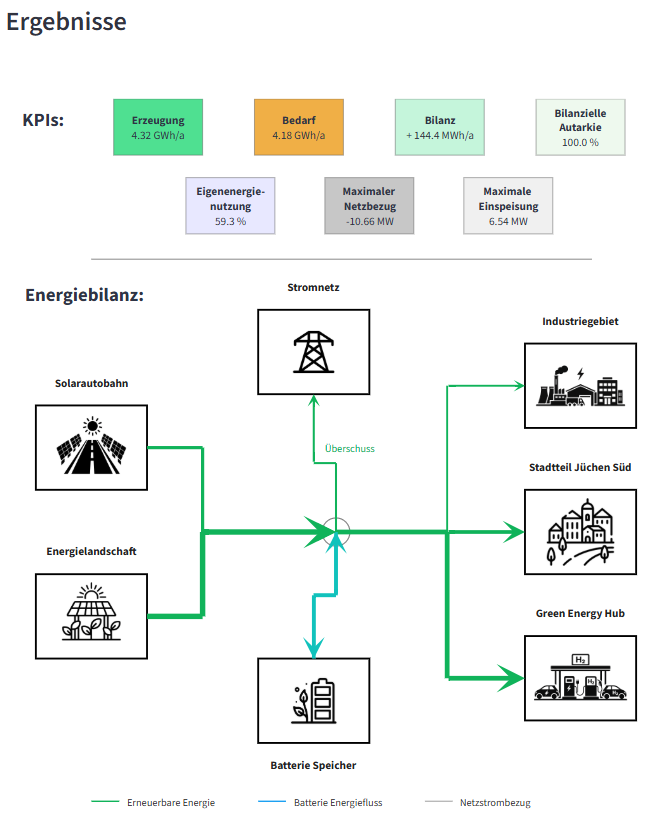
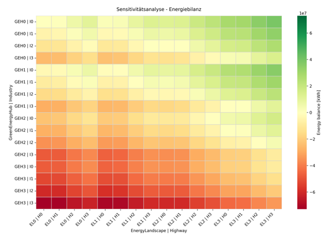

# IEEJ Energy System Modelling

A modular Python-based simulation framework for the analysis and visualization of cross-sectoral energy systems using the Innovationspark Jüchen as a case study.

The project combines a Streamlit-based web GUI with a Python simulation backend. It supports scenario-based analysis of renewable generation, electricity demand, system balance, battery storage, and sensitivity analysis on a uniform 15-minute time resolution.

## Features

- Modular simulation of cross-sectoral energy systems
- Streamlit GUI for scenario configuration and result visualization
- PV generation modelling for:
  - Solar Highway
  - Energy Landscape
- Demand modelling for:
  - Industrial Area
  - Green Energy Hub
  - Jüchen Süd
- Integrated energy balance and KPI evaluation
- Optional battery storage simulation
- Sensitivity analysis with heatmap output

## Screenshots

### GUI input interface


### Result visualization


### Sensitivity analysis heatmap


## Repository Structure

```text
IEEJ-energy_system_modelling
├── app.py
├── Simulation.py
├── requirements.txt
├── core
│   ├── functions_plot.py
│   ├── functions_web_support.py
│   ├── io_types.py
│   ├── module_battery_storage.py
│   ├── module_energy_landscape.py
│   ├── module_industrial_area.py
│   ├── module_pv_modulator.py
│   └── auxiliary
│       └── sensitivity_analysis.py
├── data
│   ├── inputs
│   └── outputs
└── .streamlit
    └── config.toml
```

## Installation

```bash
git clone https://github.com/moend95/IEEJ-energy_system_modelling.git
cd IEEJ-energy_system_modelling
pip install -r requirements.txt
```

## Run the Web GUI

```bash
streamlit run app.py
```

## Run the Precomputed Demo GUI

This demo page visualizes precomputed scenario JSON files from `data/outputs/precomputed/` and supports scenario switching without re-running the simulation.

```bash
streamlit run Web_Gui_Demo.py
```

## Static Web Frontend (precomputed scenarios)

`web_frontend/` is a static website (park map, KPIs, site plan) that only combines precomputed scenarios. Generate them with:

```bash
python generate_all_scenarios.py --count          # number of scenarios (currently 720)
python generate_all_scenarios.py --limit 10 --output-dir web_frontend/precomputed_test   # trial run
python generate_all_scenarios.py --resume         # full run into web_frontend/precomputed_v2/
```

The industrial area Elsbachtal is only offered as the base variant (one company of each type) or switched off. With `--resume`, existing scenarios are matched by their canonical key and reused (renumbered if necessary); scenarios that are no longer part of the scenario space are moved to `data/outputs/precomputed_archiv/`, nothing is deleted.

The catalog (`catalog.json`) is written into the output folder at the end of a run; the frontend reads `web_frontend/precomputed_v2/catalog.json` (override for trial runs: `index.html?catalog=./precomputed_test/catalog.json`). The output folders are not tracked in Git. Embedding into WordPress via iframe is described in `docs/einbettung.md`.

Site-plan geometries of the energy landscape are generated once with `python -m core.auxiliary.export_landscape_geometries`.

## Run the Sensitivity Analysis

```bash
python core/auxiliary/sensitivity_analysis.py
```

Scenario combinations for the sensitivity analysis are defined directly in the script.

## Input and Output Data

The repository already contains the required input data for the standard workflow in `data/inputs/`, including weather data, load profiles, scenario files, geometry files, and icons.

No additional user-provided input data is required to run the default simulation workflow.

Simulation-generated files and intermediate results are written to `data/outputs/`.

**Deprecated:** `data/inputs/green_energy_hub/*/Electrolyzer_output.csv` and `data/inputs/green_energy_hub/*/BEV_load_el_15min.csv` are no longer read by the simulation. The Green Energy Hub now generates synthetic load profiles (`core/geh_profiles.py`) based on the feasibility study "Green Energy Hub – Autohof der Zukunft" (inno2grid / PRSch, 10/2025). The files are kept for reference only.

`data/inputs/Strombezug_Stadtentwicklung_15min.csv` is now only used as the shape of the Jüchen Süd household electricity profile; it is rescaled to the annual demand and peak of the Fraunhofer IEG energy concept ("moderat" scenario).

## Main Components

- `app.py` – Streamlit GUI for input, simulation trigger, and result display
- `Simulation.py` – central simulation workflow and module integration
- `core/io_types.py` – structured input/output objects for frontend-backend communication
- `core/module_pv_modulator.py` – PV point generation, azimuth calculation, and PV simulation
- `core/module_energy_landscape.py` – Agri-PV / Energy Landscape geometry and layout generation
- `core/module_industrial_area.py` – industrial load aggregation
- `core/module_battery_storage.py` – battery storage simulation
- `core/module_green_energy_hub.py` – Green Energy Hub variants, PV at the hub, and rule-based dispatch (electrolyzer, H2 storage, battery, grid)
- `core/geh_profiles.py` – synthetic load profiles for the Green Energy Hub charging clusters, building, and H2 station
- `core/geh_sessions.py` – individual charging sessions for truck MCS and car HPC (Poisson arrivals, FIFO queue, load management at the cluster limit); default charging model `"sessions"`, smooth profiles remain available as `"profile"`
- `generate_all_scenarios.py` – scenario generator for the static web frontend
- `core/module_juechen_sued.py` – Jüchen Süd supply concepts (warm network, cold network, decentralised) from the Fraunhofer IEG energy concept, heat pump COP model, and heat dispatch
- `core/js_profiles.py` – synthetic space heating, hot water, cooling, household electricity, and e-mobility profiles for Jüchen Süd
- `core/functions_plot.py` – helper plots for load and scenario visualization
- `core/functions_web_support.py` – GUI helper functions and energy flow diagram
- `Web_Gui_Demo.py` – precomputed demo page (scenario selector, flow arrows, tooltips)

## Documentation

Detailed documentation, modelling assumptions, and module descriptions are available in the accompanying project documentation.

## Authors

Jannis Brinkmann  
Johannes Thabiso Fujo Drechsel  
Sarah Maxara  
Felix Michael Wolf  

University of Applied Sciences Cologne