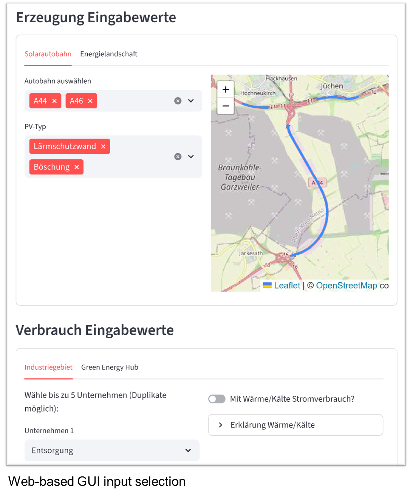

# IEEJ Energy System Modelling

A modular Python-based simulation framework for the analysis and visualization of cross-sectoral energy systems using the Innovationspark Jüchen as a case study.

The project combines a Streamlit-based web GUI with a Python simulation backend. It supports scenario-based analysis of renewable generation, electricity demand, system balance, battery storage, and sensitivity analysis on a uniform 15-minute time resolution.

## Features

- Modular simulation of cross-sectoral energy systems
- Streamlit GUI for scenario configuration and result visualization
- PV generation modelling for:
  - Solar Highway
  - Energy Landscape
- Demand modelling for:
  - Industrial Area
  - Green Energy Hub
  - Jüchen Süd
- Integrated energy balance and KPI evaluation
- Optional battery storage simulation
- Sensitivity analysis with heatmap output

## Screenshots

### GUI input interface


### Result visualization


### Sensitivity analysis heatmap


## Repository Structure

```text
IEEJ-energy_system_modelling
├── app.py
├── Simulation.py
├── requirements.txt
├── core
│   ├── functions_plot.py
│   ├── functions_web_support.py
│   ├── io_types.py
│   ├── module_battery_storage.py
│   ├── module_energy_landscape.py
│   ├── module_industrial_area.py
│   ├── module_pv_modulator.py
│   └── auxiliary
│       └── sensitivity_analysis.py
├── data
│   ├── inputs
│   └── outputs
└── .streamlit
    └── config.toml
```

## Installation

```bash
git clone https://github.com/moend95/IEEJ-energy_system_modelling.git
cd IEEJ-energy_system_modelling
pip install -r requirements.txt
```

## Run the Web GUI

```bash
streamlit run app.py
```

## Run the Precomputed Demo GUI

This demo page visualizes precomputed scenario JSON files from `data/outputs/precomputed/` and supports scenario switching without re-running the simulation.

```bash
streamlit run Web_Gui_Demo.py
```

## Run the Sensitivity Analysis

```bash
python core/auxiliary/sensitivity_analysis.py
```

Scenario combinations for the sensitivity analysis are defined directly in the script.

## Input and Output Data

The repository already contains the required input data for the standard workflow in `data/inputs/`, including weather data, load profiles, scenario files, geometry files, and icons.

No additional user-provided input data is required to run the default simulation workflow.

Simulation-generated files and intermediate results are written to `data/outputs/`.

## Main Components

- `app.py` – Streamlit GUI for input, simulation trigger, and result display
- `Simulation.py` – central simulation workflow and module integration
- `core/io_types.py` – structured input/output objects for frontend-backend communication
- `core/module_pv_modulator.py` – PV point generation, azimuth calculation, and PV simulation
- `core/module_energy_landscape.py` – Agri-PV / Energy Landscape geometry and layout generation
- `core/module_industrial_area.py` – industrial load aggregation
- `core/module_battery_storage.py` – battery storage simulation
- `core/functions_plot.py` – helper plots for load and scenario visualization
- `core/functions_web_support.py` – GUI helper functions and energy flow diagram
- `Web_Gui_Demo.py` – precomputed demo page (scenario selector, flow arrows, tooltips)

## Documentation

Detailed documentation, modelling assumptions, and module descriptions are available in the accompanying project documentation.

## Authors

Jannis Brinkmann  
Johannes Thabiso Fujo Drechsel  
Sarah Maxara  
Felix Michael Wolf  

University of Applied Sciences Cologne